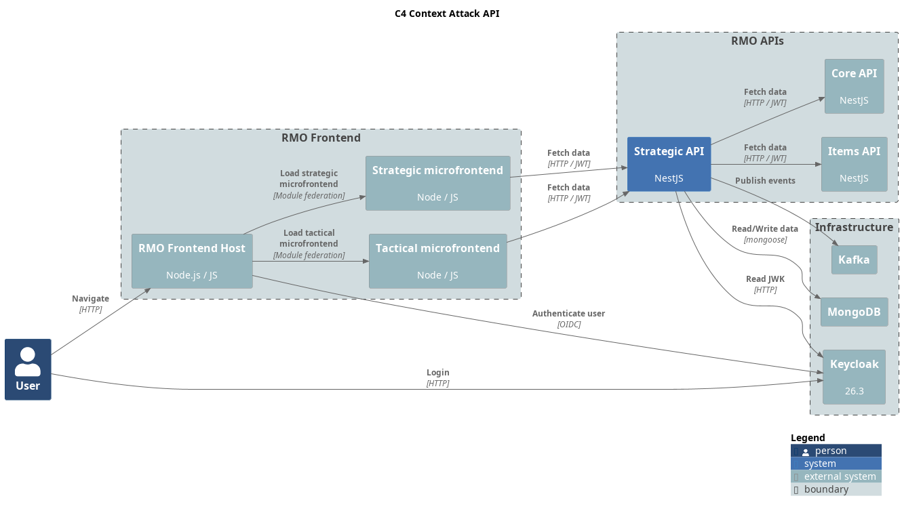

= RMU Engine Strategic API

image:https://img.shields.io/badge/license-GPL3.0-green.svg[License,link="https://www.gnu.org/licenses/gpl-3.0.html"]
image:https://img.shields.io/badge/rolemaster-rmu-green.svg[Rolemaster,link="http://ironcrown.co.uk/unified-rolemaster/"]
image:https://img.shields.io/badge/NestJS-12-green?logo=nestjs[NestJS, link="https://nestjs.com"]

++++
<a href="https://www.postman.com/labcabrera/workspace/rmu-engine/collection/5547717-39d04dee-7325-4251-86e5-e1f250cd99f2?action=share&creator=5547717&active-environment=5547717-f0da278a-5cc7-4d6c-8a82-8739ae0d1b0b" target="_blank">
  
</a>
++++

REST API for strategic management of games, factions and characters. This API is in charge of defining the
campaigns and characters of a game while the tactical API is in charge of resolving the combats that occur.

This project is part of RMU Online: https://github.com/labcabrera/rmu-platform

WARNING: *This application is an independent project developed by fans of Rolemaster Unified. It is not affiliated with, endorsed by, or licensed by Iron Crown Enterprises (ICE), the owners of the Rolemaster intellectual property.*
*All Rolemaster trademarks, game systems, and materials are the property of Iron Crown Enterprises. This software is provided for personal, non-commercial use only. If you enjoy Rolemaster, please support the official publications and content from ICE.*



== Main entities

* *Strategic Game*: A strategic game represents a campaign that can consist of several battles (tactical games). Each campaign
has a series of factions that function as if they were independent gangs.

* *Faction*: A faction is a group of characters who share resources such as items or gold.

* *Character*: Represents a character belonging to a gang with characteristics such as attributes, skills, items, etc.

== Health

Injuries, treatments, recovery and rest (workspace specs 013 and 022) under `/v1/characters/{id}`. The numbers come
from `GET /v1/healing-tables` of rmu-api-core; this repository holds only the formulas
(`domain/services/healing`).

* *Treatment difficulty*: computed on the server from `treatmentDifficulties` (procedure, injury type and severity),
one or more steps harder on the head and, when cauterizing, by the bleeding (`treatmentRules`). A procedure without a
row does not apply (400 `err-treatment-not-applicable`). The game master may still send `difficulty`, which overrides
it (stored as `difficultySource: 'override'`). `GET injuries/{injuryId}/treatment-difficulty?procedure=` previews it.
While core has no table (documents imported before spec 022) every procedure applies at medium.
* *Success*: a treatment works on a success or an absolute success, as in rmu-api-tactical; a partial success only
keeps its recovery roll modifier. Pressure stops a light bleeding and slows the rest by 4; stitches (light and medium
injuries only) stop it and halve the penalty and its recovery base, toward zero; tourniquet (limbs) and magic stop it;
cauterizing stops it (a partial success too), halves it on a failure and stores the heat critical for the game master.
An absolute failure worsens the penalty and its recovery base; the severity is computed again.
* *Healer*: a healer character subtracts its own injury penalties from Medicine and Herbalism (`healer.penalty`).
Strategic keeps no fatigue, so that is not counted.
* *Recovery*: one roll per treatment (409 `err-injury-recovery-rolled`). An untreated injury (no treatment, or a
failed one) rolls at the `none` modifier, always asks for the permanent roll and becomes permanent when it ends: with
the penalty of that roll, or all of it when it was not made (the game master can edit it).
* *Daily reduction*: front-loaded. A penalty `m` over `t` days loses `floor(m / t)` a day, and one more on each of the
first `m mod t` days.
* *Dead characters*: their injuries can be treated (the departure of the soul is out of scope), but they do not roll
recovery or rest.

== Equipment and gold

Items of characters and factions (workspace spec 023). An item is an instance of a catalog type of rmu-api-items: it
copies what it needs of it (`catalog`: cost, rarity, production hours, image; `value`), and is customized with
modifiers that keep their origin (`source.kind`: `tactical`, `manual`, `crafting`, `repair`, `catalog`). A +5 sword is
`{type: 'quality', appliesTo: 'attack', value: 5}`; a masterwork is `{type: 'quality', appliesTo: 'breakage', value: 10}`
(Strength in breakage checks).

* *Holder*: a character or a faction (its armory) of the same game, stored as `characterId` or `factionId` and
returned as `holder`. A character can act on its items (its owner); the armory and the gold of a faction are for the
game master. A player may give items of its character to its faction or to a character of that faction.
* *Gold*: `management.availableGold` of a faction, and a `gold-coin` stack of a character (coins weigh). Every write is
conditional on the version read, and an operation undoes its earlier steps when a later one fails (the Mongo of
compose is standalone, without transactions).
* *Operations* (each with an entry in `GET /v1/item-ledger`, filterable by `itemId`, `holderIds`, `gameId`, `kind`):
** `POST /v1/items/purchases`: average cost or asked `unitPrice`, times the Trading percent. A character pays with
its coins, its faction (`payer: faction`) or both (`split`); spending faction gold needs the game master.
`POST /v1/items` is kept as its alias.
** `POST /v1/items/{id}/sale`: value × sale percent × condition percent × Trading percent, unless `unitPrice`.
** `POST /v1/items/{id}/transfer`: to another holder; units of a stack join the stack of the new holder, and coins
given to a faction become its gold.
** `POST /v1/items/crafts`: Crafting maneuver on the `crafting` table of core. Materials (a percent of the average
cost, or `materialsCost`) plus `enhancementsCost` are paid and lost on a failure; a success adds the enhancements
and the Strength change of the result.
** `POST /v1/items/{id}/repairs`: maneuver with the damage of the item as a penalty (-100 if broken) on the `repair`
table of core (imported data, Core Law table 6-2); the result removes, halves or keeps the breakage modifiers, leaves
a broken item at a permanent -10, or makes it unrepairable.
** `POST /v1/items/{id}/discard` and `POST /v1/items/price-quotes` (the price of a purchase or sale without making it).
* *Trading*: an opposed percent maneuver (`GET /v1/maneuvers/percent` of core). Buying, the price is 200% less the
percent; selling, it is the percent; both between 50% and 200%. The Trading of the merchant goes in `modifiers`.
* *House rules*: `RMU_STRATEGIC_SALE_PERCENT` (50), `RMU_STRATEGIC_MATERIALS_PERCENT` (50) and
`RMU_STRATEGIC_CONDITION_PERCENTS` (`100,50,10`: intact, damaged, broken), shown by `GET /v1/economy-rules`; a request
can override the sale percent and the materials cost.

== Development

This API follows the platform and conventions of https://github.com/labcabrera/rmu-api-core[rmu-api-core] (workspace
spec 020): Node.js 24 (`nvm use`), pnpm 10 through corepack, native ESM with relative `.js` imports, SWC build, Vitest
and the hexagonal + CQRS layout of core's README (*Project layout*, *HTTP contract*).

```bash
cp .env.example .env   # host ports of the rmu-platform infrastructure (make up-infra)
pnpm install
pnpm start:dev         # http://localhost:3002, Swagger UI on /api-docs, OpenAPI JSON on /api-spec
make check             # lint, typecheck, unit and e2e tests
```

[cols="1,3"]
|===
| Command | What it does

| `pnpm build` / `pnpm typecheck` | SWC build to `dist/` / `tsc --noEmit`
| `pnpm lint` / `pnpm format` | typed ESLint + Prettier / Prettier over `src` and `test`
| `pnpm test` | unit tests (`test/unit`)
| `pnpm test:e2e` | one file per resource booting `AppModule` against mongodb-memory-server, with tokens signed against a local JWKS; calls to other APIs and the Kafka producer are replaced (`test/e2e/support`)
| `pnpm test:cov` | unit and e2e tests with the coverage thresholds of `vitest.config.ts` (what CI runs)
| `make docker-build` / `make docker-run` | image `labcabrera/rmu-api-strategic:latest` (`node:24-bookworm-slim`, `node` user, `HEALTHCHECK`); `docker-run` needs `.env.docker`
| `make create-release` | semantic-release from a clean `develop` into `main`
|===

The Joi schema in `src/config/env.schema.ts` fails startup on a missing required variable. Besides `PORT` (`3002`),
`LOG_LEVEL` (`info`) and `RMU_MONGO_STRATEGIC_URI`, the HTTP layer reads `RMU_CORS_ORIGINS` (empty: no CORS, browsers come through the
gateway), `RMU_THROTTLE_LIMIT` / `RMU_THROTTLE_TTL_MS` (`300` per `60000` ms and client IP, `0` turns it off) and
`RMU_TRUST_PROXY` (`loopback, linklocal, uniquelocal`).

Errors answer `{ statusCode, error, code, message, timestamp, path }`. Responses carry the `version` of the entity and a
`PATCH` may send it back: a stale one is a 409 `version-conflict`. `size` goes up to 100. `GET /v1/characters` and `GET /v1/items` accept up to 1000 (`CatalogPagedQueryDto`), because rmu-api-tactical loads them whole. Rule violations carry their `err-*` key in `code`, which rmu-mfe-strategic translates (the deprecated `errorCode` alias was removed in workspace spec 021).
Open problems found during the migration are listed in `docs/reports/api-template-rollout-findings.md` of the workspace.
